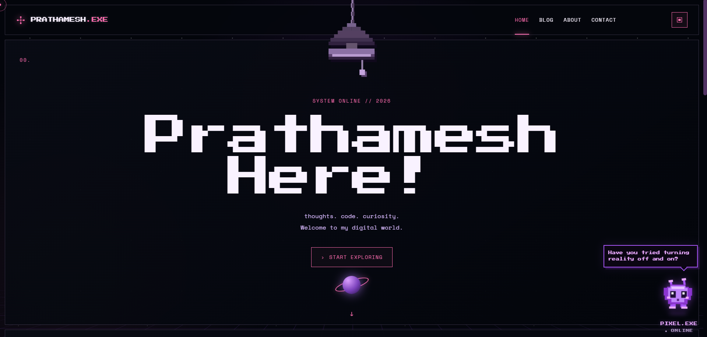
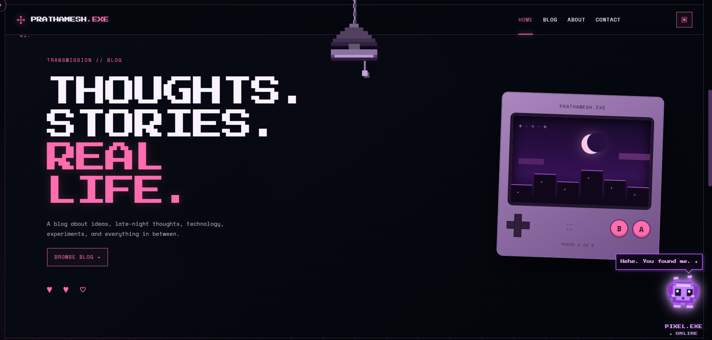

# ✦ PRATHAMESH.EXE



<p align="center">
  <samp>THOUGHTS. CODE. CURIOSITY.</samp>
  <br><br>
  <em>A little world somewhere between the internet and outer space.</em>
  <br><br>
  <code>PERSONAL WEBSITE&nbsp; / &nbsp;Y2K AESTHETIC&nbsp; / &nbsp;INTERACTIVE WEB EXPERIMENT</code>
</p>


<p align="center">
  <strong>◈ EXPLORE THE INTERFACE · DISCOVER THE SECRETS · MEET PIXEL</strong>
</p>

---

## `00` — SYSTEM OVERVIEW

PRATHAMESH.EXE is a personal website inspired by Y2K interfaces, pixel art, cosmic imagery, and the early internet.

Instead of treating a portfolio as a static page, it experiments with making a website feel like a place of its own: a retro-inspired digital environment with an interactive terminal, a tiny alien companion, a pixel-art lamp, and hidden surprises.

```text
┌─────────────────────────────────────┐
│  SYSTEM       PRATHAMESH.EXE         │
│  AESTHETIC    RETRO-FUTURISTIC       │
│  ENVIRONMENT  WEB BROWSER            │
│  STATUS       UNDER DEVELOPMENT     │
└─────────────────────────────────────┘
```

## `01` — EXPLORE THE SYSTEM

### 💻 The interface

- A cosmic backdrop featuring layered stars, shooting stars, and a grid floor.
- A retro-inspired loading sequence with animated progress and system messages.
- Section navigation with active states and scroll-triggered reveals.
- Magnetic hover effects and a tilt interaction on the Game Boy illustration.

<!-- SCREENSHOT 02: LANDING PAGE
     Recommended file: assets/homepage.png
     Capture the homepage with the navigation and hero section visible.
     Insert this image directly below the bullets above if you want
     a second, more detailed view of the landing page. -->

### ▣ The terminal

An interactive terminal with commands for exploring the site's content and switching its visual mode.

| Command | Function |
|:--|:--|
| `help` | Lists available commands |
| `about` | Displays a short introduction |
| `projects` | Shows the built-in project list |
| `blog` | Displays the blog description |
| `contact` | Points towards the contact section |
| `stardance` | Toggles Stardance mode |
| `normal` | Returns to the default visual mode |
| `clear` | Clears the terminal output |

<!-- SCREENSHOT 03: TERMINAL
     Recommended file: assets/terminal.png
     Open the terminal and enter "help" before taking the screenshot.
     Insert the image directly below this terminal section. -->

### 👾 PIXEL.EXE

Meet the tiny digital alien living on the page.

The companion has its own pixel-art sprite, status display, speech bubble, and interaction menu.

- ♡ **Pet**
- ✦ **Feed**
- ♫ **Dance**
- ? **Help**

<!-- SCREENSHOT 04: PIXEL COMPANION
     Recommended file: assets/pixel-companion.png
     Capture Pixel with the interaction window open.
     Insert the image directly below this section. -->

### 🎮 The Game Boy

A miniature retro-console-inspired visual with a pixel-art city scene and interactive A and B buttons.

Press either button to trigger a randomly selected message. It's a small detail, but that's the point.

<!-- SCREENSHOT 05: GAME BOY
     Recommended file: assets/gameboy.png
     Capture the console with its screen and A/B buttons visible.
     This screenshot is optional. -->

### 💡 The pixel lamp

A hanging pixel-art lamp with an interactive switch and a bright illumination effect.

Switch it on and let the glow change the atmosphere of the page.

<!-- SCREENSHOT 06: PIXEL LAMP
     Recommended file: assets/pixel-lamp.png
     Capture the actual website with the lamp switched ON and visibly glowing.
     Insert the image directly below this section. -->

### ✦ Signal Centre

The contact section opens a dedicated signal-centre interface with contact cards for email, GitHub, LinkedIn, and Instagram.

The current HTML contains placeholder contact details, so those links need to be configured before the site is published.

## `02` — SECRETS & EASTER EGGS

Some of the fun is in knowing where to look.

### The Stardance sequence

Type the letters `stardance` consecutively while the page is active, without typing inside the terminal input.

The page triggers a brief hue-shift animation and displays a Stardance notification.

### Terminal discovery

Open the terminal using the square icon in the navigation bar and enter:

```text
help
```

Then experiment with the commands listed above.

### Pixel Window Buddy

Click on the pixel bot at the bottom-right corner five times consecutively to unleash the minions!


### Pixel interactions

Open Pixel's menu and try each of its four controls.

### Game Boy buttons

Press A and B to reveal different sets of messages.

*Keyboard shortcut note: the documented secret is a typed character sequence, not a dedicated function-key combination.*

## `03` — DESIGN LANGUAGE

```text
PALETTE       BLACK / HOT PINK / PURPLE / LAVENDER
TYPOGRAPHY    PRESS START 2P / SPACE MONO
INSPIRATION   Y2K / PIXEL ART / EARLY INTERNET
ATMOSPHERE    COSMIC / DIGITAL / RETRO-FUTURISTIC
```

The design borrows from an era when websites felt like individual places rather than interchangeable templates. Pixel details, terminal panels, and cosmic visuals create a consistent visual identity.

The goal isn't to add animation everywhere. It's to make the interface, its interactions, and its atmosphere feel like parts of the same world.

## `04` — BUILT WITH

| Technology | Purpose |
|:--|:--|
| HTML5 | Structure and content |
| CSS3 | Layout, styling, and visual effects |
| JavaScript | Interactions, terminal commands, and Easter eggs |
| Google Fonts | Press Start 2P and Space Mono |
| Git & GitHub | Version control and source hosting |

The project uses browser-native technologies without a large frontend framework.

## `05` — RUN LOCALLY

**Requirements:** A modern browser and the complete project files.

Keep `index.html`, `style.css`, `script.js`, `model.js` (if used by your project), and the referenced assets in their correct locations.

Open `index.html` in a browser, or open the project folder in VS Code and use a local development server.

No package installation is indicated by the supplied HTML and JavaScript. Any additional dependencies or setup requirements should be documented if the project needs them.

## `06` — PROJECT STATUS

**Status:** Deployed
**Live demo:** Out!

## `07` — CREDITS

- [Google Fonts](https://fonts.google.com/) — Press Start 2P and Space Mono.
- ChatGPT Codex used for advanced animations and debugging.
- Nano Banana used for image generation

---

<p align="center">
  <samp>END OF TRANSMISSION</samp>
  <br><br>
  <strong>PRATHAMESH.EXE</strong>
  <br>
  <em>A personal website. A digital playground. A work in progress.</em>
  <br><br>
  <code>CONNECTION TERMINATED_</code>
</p>
